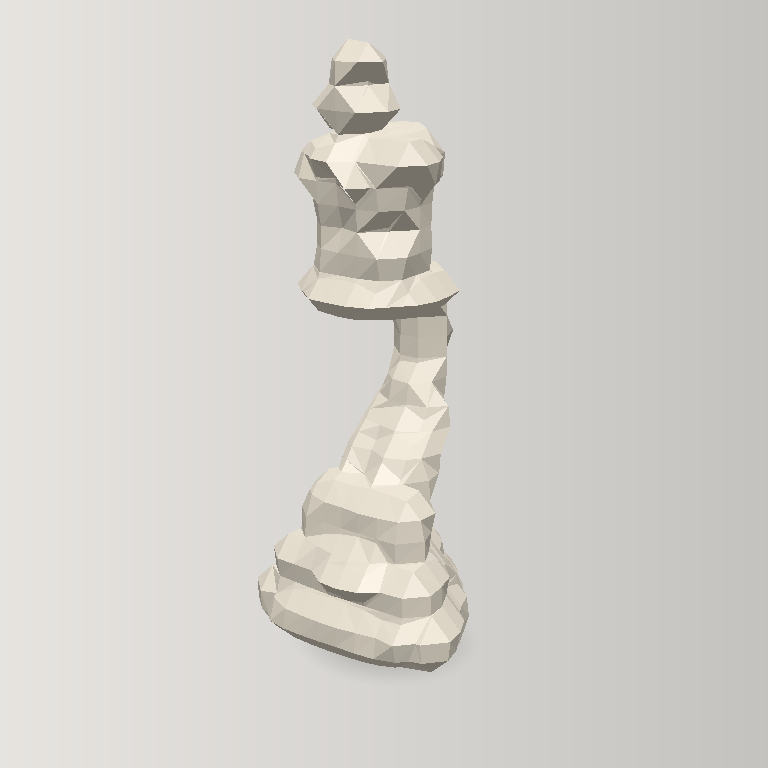

# Chess Pieces Corpus

A public set of 3D chess pieces, indexed so a project can load a style without guessing folder names.

Two style modules are in the catalog:

- `classic-lowpoly` — faceted Staunton-like pieces, flat-shaded
- `ai-triposr-v1` — TripoSR reconstructions of SDXL concept renders, smooth-shaded

Each module has six piece types and two sides. White and black share geometry. The GLB material is ivory for white and ebony for black.



## Measured meshes

Heights, widths, and depths are axis-aligned bounding boxes in the mesh's own units. Height is Y. The normalize step kept each piece's existing long-axis length and stood that axis up. `chesscorpus report` prints this table from `mesh_stats.json`.

| Style | Piece | Vertices | Unique | Faces | Height | Width | Depth |
| --- | --- | ---: | ---: | ---: | ---: | ---: | ---: |
| classic-lowpoly | king | 4488 | 750 | 1496 | 1.0649 | 0.4058 | 0.3541 |
| classic-lowpoly | queen | 4752 | 794 | 1584 | 1.0306 | 0.4801 | 0.3633 |
| classic-lowpoly | rook | 6000 | 1002 | 2000 | 1.0384 | 0.5515 | 0.3414 |
| classic-lowpoly | bishop | 5904 | 986 | 1968 | 1.0631 | 0.4404 | 0.4408 |
| classic-lowpoly | knight | 8388 | 1398 | 2796 | 1.0353 | 0.5518 | 0.4802 |
| classic-lowpoly | pawn | 6972 | 1164 | 2324 | 1.0603 | 0.549 | 0.4027 |
| ai-triposr-v1 | king | 32308 | 32288 | 64612 | 0.9997 | 0.4034 | 0.4501 |
| ai-triposr-v1 | queen | 44834 | 44804 | 89656 | 1.0337 | 0.458 | 0.5475 |
| ai-triposr-v1 | rook | 41186 | 41166 | 82368 | 1.0187 | 0.4687 | 0.478 |
| ai-triposr-v1 | bishop | 30270 | 30262 | 60532 | 0.9209 | 0.4017 | 0.5184 |
| ai-triposr-v1 | knight | 71012 | 70981 | 142020 | 1.015 | 0.6326 | 0.7697 |
| ai-triposr-v1 | pawn | 36070 | 36049 | 72136 | 1.0225 | 0.4682 | 0.5079 |

`classic-lowpoly` stores one vertex per corner so the facets stay hard. Its unique-position counts are the welded meshes: 750, 794, 1002, 986, 1398, and 1164. `ai-triposr-v1` keeps a shared vertex buffer and smooth normals. Face counts are unchanged from the meshes originally committed to this repo.

The TripoSR pieces still carry reconstruction artifacts. The bishop is the clearest example: a thin stem and a lumpy mitre. `styles/ai-triposr-v1/references/` keeps the 1024×1024 concept renders those meshes were built from. `styles/classic-lowpoly/references/` keeps the original 1024×1024 studio stills. The files in `previews/` are 768×768 renders of the GLBs.

## Layout

```text
catalog.json
preview/                 gallery (static HTML, three.js from a CDN)
src/chesscorpus/         validator, normalizer, preview renderer
styles/<style-id>/
  style.json
  mesh_stats.json
  README.md
  models/white/{king,queen,rook,bishop,knight,pawn}.glb
  models/black/{king,queen,rook,bishop,knight,pawn}.glb
  previews/{king,queen,rook,bishop,knight,pawn}.png
  references/            optional source stills, not part of the load contract
```

`catalog.json` is schema 1.1.0. Each style entry points at `style.json`. Paths inside a style manifest are relative to that style folder.

Every shipped mesh uses the same pose:

- glTF Y-up, base on `y = 0`
- footprint centered on X and Z
- an asymmetric crown yaws to face −Z
- outward triangle winding and unit normals

## Setup

Requires Python 3.11 or newer. Continuous integration runs on Python 3.12.

```bash
python3 -m venv .venv
source .venv/bin/activate
pip install -e ".[dev]"
```

Check the corpus:

```bash
chesscorpus validate
ruff check src tests
ruff format --check src tests
pytest
```

`pytest` runs 12 tests: orientation math, GLB round-trip, preview framing, and a full pass over this checkout.

## Usage

Open the gallery from the repository root:

```bash
chesscorpus preview
```

Then visit <http://127.0.0.1:8000/preview/>. The page reads `catalog.json`, shows the stills, and orbits the GLB for the selected side. The 3D view loads three.js 0.187.0 from a CDN.

To load a style in your own code, read `catalog.json`, open that style's `style.json`, and resolve `models.white` / `models.black`. See [docs/MODULAR_USAGE.md](docs/MODULAR_USAGE.md).

Other commands, all from the repository root:

| Command | What it does |
| --- | --- |
| `chesscorpus validate` | Check manifests, GLBs, stats, and previews |
| `chesscorpus normalize` | Rewrite GLBs into the pose above and refresh `mesh_stats.json` |
| `chesscorpus render` | Rewrite `previews/*.png` from the white GLBs |
| `chesscorpus report` | Print the measured mesh table |

## Contributing

See [CONTRIBUTING.md](CONTRIBUTING.md) and [RULESET.md](RULESET.md). A new style is a folder under `styles/` plus a `catalog.json` entry. GitHub Actions runs the linters and `pytest` on every push and pull request.

## License

The meshes, stills, and tooling in this repository are CC BY 4.0. Credit the author named in each style's `style.json`. The license text and link live in [LICENSE](LICENSE).

[docs/ATTRIBUTION.md](docs/ATTRIBUTION.md) records an external Sketchfab model that was selected as a future source. That model is not in `catalog.json`.
